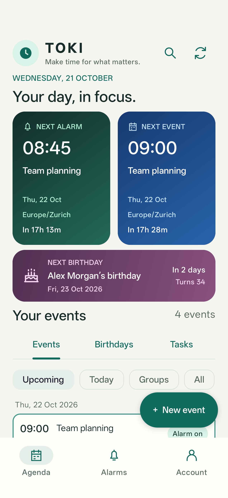
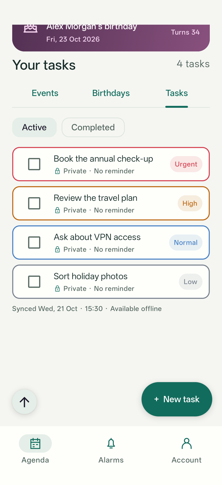
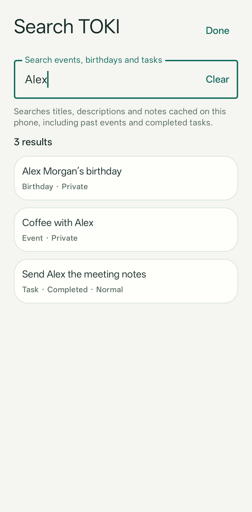

# TOKI

TOKI is a deadline management project with a PocketBase backend and a working Kotlin/Compose Android app. It captures lightweight private tasks and helps users remember meetings and recurring events, such as birthdays, through audible reminders—normally five minutes before an event.


## Current status

- A remote PocketBase backend has been configured at `https://pocketbase.hacking-lab.com`.
- This repository contains Python authorization and recurrence regression tests. The two-user remote suite returned **54 PASS, 0 FAIL**, including deletion of all four temporary records. Local group validation also passes the four-user private regression and group authorization checks described below.
- Group events and personal reminder preferences are deployed to Jupiter; the live group suite passed **75 checks with 0 failures**. See [group events](backend/GROUPS.md).
- The Android app implements sign-in, offline Room caching, private event creation/editing, permission-aware event deletion, private/group deadline viewing, and timed one-off/recurring audible reminders. Its Agenda has compact event rows, toolbar search, and next-alarm/next-event tiles ordered by time. New events and displayed timestamps use the phone’s time zone by default. See the [Android guide](android/README.md) for setup, tests, and current limits.
- Private **Tasks** are deployed on Jupiter and available in Android alongside Events and Birthdays: quick title capture, Urgent/High/Normal/Low priority, optional notes/reminder, completion/reopening, and deletion. See the [task guide](backend/TASKS.md).
- An [iOS SwiftUI/AlarmKit prototype](ios/README.md) provides a native 30-second test alarm for iOS 26+. PocketBase integration and event management are not yet implemented on iOS.
- Captured Docker deployment files, collection schema, access rules, and a fresh-instance migration are included. See the [backend guide](backend/README.md) for the verified local setup and remaining operational configuration.

## App screenshots

Real Android screens with fictional sample data. See the [illustrated user guide](docs/ANDROID_GUIDE.md) for all ten screenshots and step-by-step usage.

<p>
  
  
  
</p>

## Architecture

```text
PocketBase                         Android app
Authentication            <--REST-->  Synchronization
Private events, birthdays, tasks      Local Room database
Recurrence rules                      Occurrence calculation
                                      AlarmManager → audible reminders
```

PocketBase stores events, birthdays and tasks and controls access to each user's records. Android caches them locally, calculates upcoming occurrences, and schedules reminders on the device so cached reminders work offline. Sync runs on sign-in, after event/birthday creation and editing, and when requested manually. Task writes update the local cache and alarms from the server response. Global search uses the cache without a network request.

The app uses **Kotlin, Jetpack Compose, Room, and AlarmManager**. Alarm-clock scheduling drives a foreground audio player and a lock-screen Dismiss screen. Notification and exact-alarm permissions are required; full-screen alarm access enables the lock-screen display. Cached alarms are restored after reboot/unlock, app updates, and clock/time-zone changes.

Private tasks use a separate collection, remain active until completed, and sort by priority then newest first. Priority does not trigger alarms. Optional reminders ring once; completed tasks stay in Completed until manually reopened or deleted.

Private birthdays are a separate yearly event type with an optional birth year, a local 09:00 reminder by default, and a selectable February 29 policy. See [birthday setup and backend rollout](backend/BIRTHDAYS.md).

## Deadline model

The test suite expects a `users` authentication collection and a `deadlines` collection with these fields:

| Field | Purpose |
| --- | --- |
| `owner` | Private owner or shared-event creator |
| `group` | Optional group relation; empty for private events |
| `title`, `description` | Event details |
| `start_at` | Start timestamp represented in UTC |
| `timezone` | IANA time zone, such as `Europe/Zurich` |
| `rrule` | iCalendar recurrence rule; empty for a one-off event |
| `exdates` | JSON array of excluded occurrences |
| `rdates` | JSON array of additional occurrences |
| `duration_minutes` | Event duration |
| `reminder_minutes` | Reminder offset before the event |
| `all_day` | Whether the event is an all-day event |
| `enabled` | Whether the deadline is enabled |

Private deadlines are visible only to their owner. Group deadlines are visible to group members and managed by group admins. Each user can keep private reminder preferences for a shared event. Ownership and an event's group are immutable. See the [group model and rollout guide](backend/GROUPS.md).

PocketBase stores recurrence data; Android calculates occurrences locally. For example, a Monday meeting at 09:00 in Zurich can use:

```json
{
  "start_at": "2026-10-26 08:00:00.000Z",
  "timezone": "Europe/Zurich",
  "rrule": "FREQ=WEEKLY;BYDAY=MO",
  "exdates": ["2026-11-02T09:00:00"],
  "rdates": ["2026-11-04T09:00:00"]
}
```

This excludes November 2 and adds November 4 at 09:00 local time. These exception strings follow the local-time format used by the current tests. Timed recurrence supports DST transitions, exclusions/additions, and offline advancement. Existing series keep their saved event zone, while the app displays times in the phone’s current zone. Generic all-day deadline reminders are not scheduled until an explicit reminder-time policy is defined; the dedicated Birthday type has its own local reminder time. See the [recurrence contract](android/README.md#recurrence).

## Use the Android app

1. Install the debug build from Android Studio or follow the [build instructions](android/README.md#build-and-verify), then sign in with a PocketBase user account.
2. Open **Alarms**, enable Notifications and Exact alarms, and enable Lock-screen display. Try the 30-second test before relying on reminders.
3. In **Agenda → Events**, tap **+ New event** to create a private event. Use **Birthdays → + New birthday** for annual birthdays or **Tasks → + New task** for quick capture. Each list opens its own creation form. Enabled, a five-minute reminder, a 60-minute duration, and the phone’s time zone are the defaults. The initial date/time is one hour ahead. Saving requires a connection and automatically syncs the event.
4. The green **Next alarm** and blue **Next event** tiles show the earlier time on the left. Tap a populated summary tile to open that item’s details. After an alarm, the event stays visible as **Due soon** until its deadline. Past one-off events remain under **All**.
5. To delete an event, refresh once to load permissions, expand its row, tap **Delete event**, and confirm. Recurring deletion removes the entire series; shared events are deleted for everyone and require group owner/admin rights.
6. After scrolling down, use the small **↑ Back to top** button on the left; the create button stays on the right.
7. Use the magnifying glass left of refresh to search all cached events, birthdays and tasks, including completed tasks; select a result to open its list and details. Tap a compact event row for details. **Today** uses the phone’s date. Refresh after changes made in PocketBase.

8. Use Android **Back** to return from details, scrolled lists, Alarms or Account to the top of Agenda. Open forms, search and dialogs close first. Alarms and Account also offer **Return to main page**. Only Back from the main overview leaves TOKI. See the [navigation guide](docs/ANDROID_GUIDE.md#return-to-the-main-page).

Expand an event and tap **Edit event** to update a regular event or birthday in Android; saving syncs changes and rebuilds reminders. Group event creation, memberships, and personal reminder preferences are managed in PocketBase. Android does not poll in the background. Imported all-day calendar entries are shown without alarms. See the [Android guide](android/README.md) for limitations and troubleshooting.

## Repository layout

```text
android/                         Kotlin/Compose Android application and tests
ios/                             SwiftUI/AlarmKit iOS prototype and Xcode project
backend/docker/                  Captured deployment and isolated local Compose setup
backend/pb_migrations/           Baseline and group-event schema migrations
backend/schema/                  Target collection schema and access rules
backend/scripts/                 Jupiter migration rehearsal, deployment, and checks
backend/fixtures/                Shared Python/Kotlin recurrence cases
backend/pocketbase-tests/        API authorization, group, and recurrence tests
  config.ini.example             Configuration template
  config.ini                     Local credentials; ignored by Git
```

## Run the tests

Use Python 3.9 or newer with IANA time-zone data available. The Pipenv configuration specifies Python 3.14; these commands use a standard virtual environment.

```sh
cd backend/pocketbase-tests
python3 -m venv .venv
source .venv/bin/activate
python -m pip install -r requirements.txt
# For initial setup only; retain an existing configured file.
cp config.ini.example config.ini
```

Edit `config.ini` with your backend URL and existing test accounts. **Keys in `[users]` and `[passwords]` must match.** For example:

```ini
[pocketbase]
url = https://pocketbase.hacking-lab.com
timeout = 15

[users]
ivan = user1@example.com
marina = user2@example.com

[passwords]
ivan = REPLACE_WITH_PASSWORD
marina = REPLACE_WITH_PASSWORD
```

Keep real passwords in the ignored `config.ini`. Do not commit credentials.

```sh
# Full suite
python testing.py -all

# Select an attacker account for cross-user checks
python testing.py -user ivan

# Use another configuration file
python testing.py -all -config /path/to/config.ini
```

`-user ivan` still authenticates all configured users and creates records for them; it selects Ivan for cross-user attack attempts. Use at least two test accounts for cross-user coverage.

The suite creates disabled temporary deadlines with a `PBSEC-` prefix, updates them, attempts unauthorized operations, and deletes tracked records during cleanup. Check the output for any records requiring manual removal. The process exits with status `1` if any checks fail.

### Coverage and limits

API tests cover authentication, own-record operations, cross-user and anonymous access attempts, recurrence exception persistence, and cleanup. Two local Python `dateutil` checks cover recurrence expansion and preservation of 09:00 Zurich time across the spring daylight-saving transition.

The Python recurrence checks do not execute Android code or validate audible delivery. Android has separate unit and phone UI tests; verification on October 22, 2026 passed 53 unit tests and 52 phone UI/API/cache checks, including calendar settings, wildcard preview/scoping, hide/restore and calendar preference synchronization, together with build and lint. The separate screenshot capture was last verified on October 21, 2026. See the [Android testing guide](android/README.md#build-and-verify). Ownership-transfer tests target another real user. List checks filter by the known temporary record ID to avoid pagination gaps, and anonymous list access must not expose that record. Unexpectedly created records are tracked for cleanup, with other configured users tried if ownership has changed. These checks do not constitute a complete security audit.

## Calendar imports

Published Outlook calendars can be imported on Jupiter every four hours, with a recipient TOKI account configured per calendar. Android downloads changes when opened or manually synced, without background polling. Imported meetings show source labels, deduplicate by calendar identity and use five-minute reminders; all-day entries have no alarm. In Android, **Hide in TOKI** hides one imported occurrence and cancels its future alarm; **Events → Hidden events** lets you restore it. Preferences sync per account and survive reimports. Users manage private calendar links and wildcard exclusion rules in **Account → Calendars & exclusions**. Patterns such as `Marina *` can cover all their calendars or one source; matches are removed on the next successful import. See the [calendar integration guide](backend/calendar-sync/README.md).

## Next steps

1. Retain the verified migration backup and maintain the [deployment and recovery instructions](backend/GROUPS.md). Group sharing and SMTP are working on Jupiter.
2. Validate a fresh backend installation with the strengthened regression suite.
3. Define the all-day reminder-time policy. Timed recurrence, time zones, exclusions/additions, and shared Python/Kotlin fixtures are implemented.
4. Consider group event creation and personal preference controls in Android. Synchronization runs when the app opens or on manual refresh; background polling is intentionally omitted.
5. Verify reminders on devices, including offline operation, reboot recovery, permission changes, and edited or deleted events.
