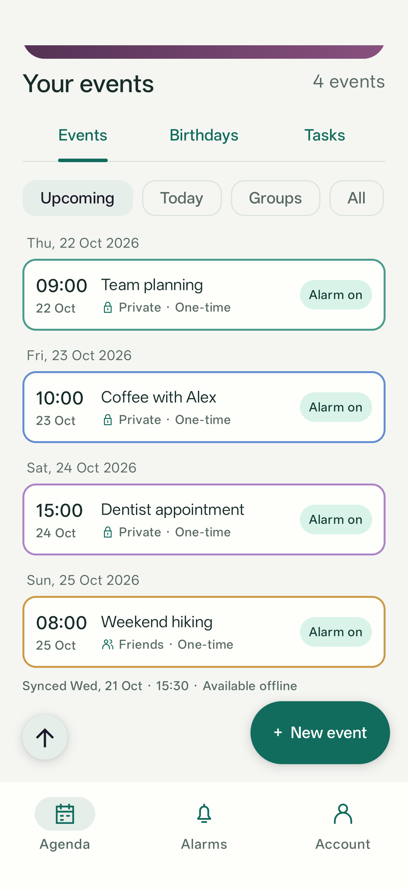
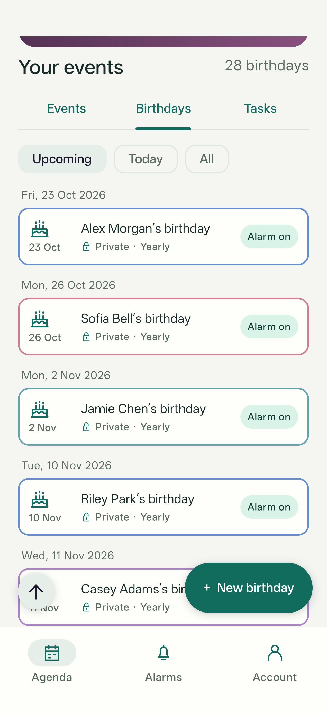
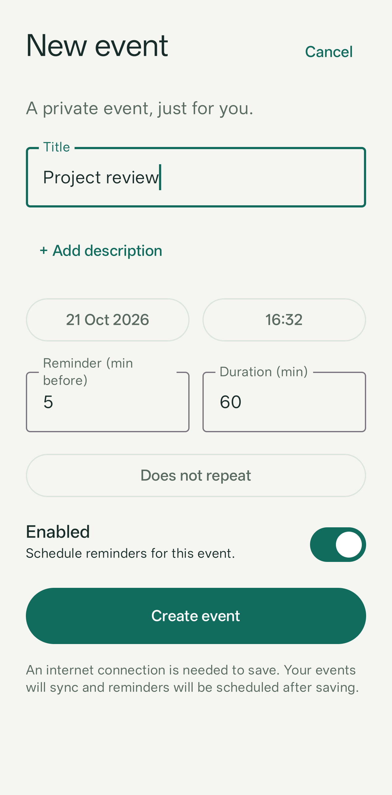
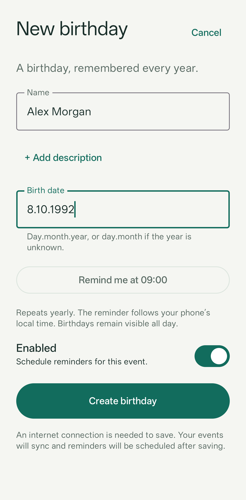
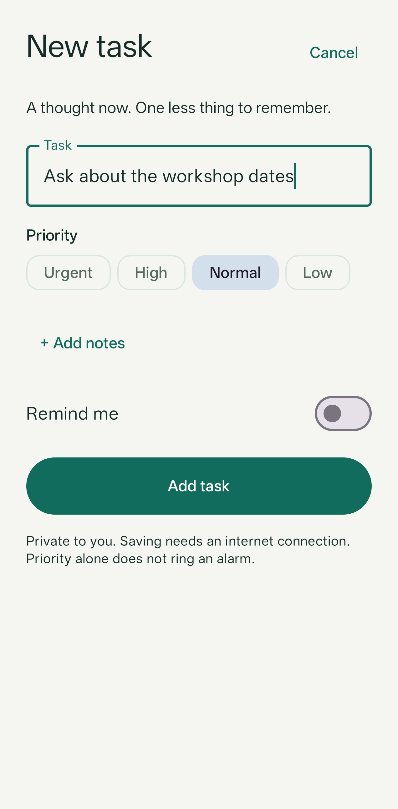
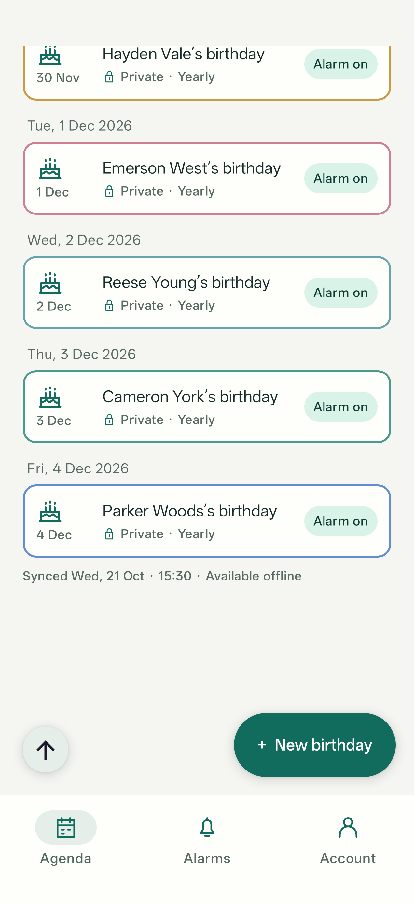
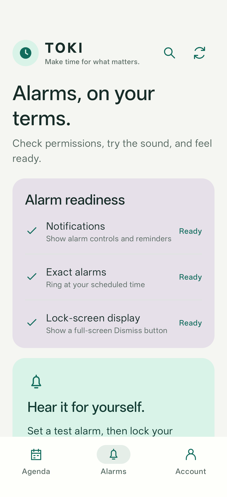

# TOKI Android user guide

TOKI keeps dated events, yearly birthdays and quick tasks in separate lists. This guide describes the Android app as of 22 October 2026. The screenshots were captured on 21 October 2026 from the real Compose screens on an Android phone with fictional sample data; no personal records or credentials are pictured.

For building, installation, recurrence details and troubleshooting, see the [Android technical guide](../android/README.md). The [iOS app](../ios/README.md) is currently an alarm prototype and does not yet provide these screens.

## Your day at a glance

The green **Next alarm** and blue **Next event** tiles put the earlier time on the left. The purple **Next birthday** tile shows the next birthday and upcoming age when the birth year is known. Tap a populated summary tile to jump to its list, scroll to that exact item and expand its details. Next alarm can open an event, birthday or task; Next event opens the event; Next birthday opens the birthday. Use the Android Back gesture or button to close those details and return to the list and position you came from. If a form or dialog is open, Back dismisses that first. Test-alarm, setup and empty-alarm tiles open alarm controls. An empty birthday tile opens the Birthdays list; an empty event tile has no detail action. Times use the phone's current time zone.

An event stays visible until its deadline, even after its reminder rings. A birthday stays visible all day. Tasks stay active until you complete them.

## Choose the right list

| List | Use it for | Create button |
| --- | --- | --- |
| Events | Meetings, appointments and recurring deadlines | **+ New event** |
| Birthdays | Annual birthdays, with an optional birth year | **+ New birthday** |
| Tasks | Quick thoughts and things to do | **+ New task** |

Each create button opens only the form for its selected list. There is no Event/Birthday selector inside a form.

### Events

Events sort by their displayed date and time. Date headings include the year; matching dates share a border color. Use **Upcoming**, **Today**, **Groups** or **All**. Past one-off events remain under All.

Tap a row to expand its description, recurrence and reminder details. **Edit event** and **Delete event** appear for your own private events and group events you own/administer. Recurring edits and deletion apply to the whole series. Shared changes affect all members. Deletion asks for confirmation.

### Birthdays

Birthdays have cake icons and their own **Upcoming**, **Today** and **All** filters. A birthday remains visible until local midnight after its reminder. The reminder defaults to **09:00 in the phone's time zone** and repeats annually.

Tap a birthday to inspect its age, reminder time and notes, or edit/delete it. For February 29, choose February 28 or March 1 in non-leap years. See the [birthday model](../backend/BIRTHDAYS.md) for exact scheduling behaviour.

### Tasks

Tasks are private and default to **Normal** priority. They sort **Urgent → High → Normal → Low**, newest first within each priority. Priority alone never rings an alarm.

Check a task to move it to **Completed** and cancel its pending reminder on this phone. Uncheck it there to reopen it. A reminder that has already passed does not repeat. Tasks stay active after reminders, and completed tasks remain until manually deleted. Expand a row for **Edit task** and **Delete task**. See the [task model](../backend/TASKS.md).

## Create something new

| Event | Birthday | Task |
| --- | --- | --- |
|  |  |  |

- **Event:** enter a title, choose date/time and optionally adjust the reminder, duration or repeat. Enabled is preselected; defaults are a five-minute reminder, 60-minute duration and a start time one hour ahead. The phone's time zone is applied automatically. Description stays collapsed until needed.
- **Birthday:** enter a name and `day.month.year`, such as `8.10.1992`. Use `8.10` when the year is unknown. Choose a reminder time if 09:00 does not suit you. Description is optional.
- **Task:** only a title is needed. Change priority when useful; expand notes or turn on **Remind me** to add a one-off reminder. Normal priority and no reminder are the defaults.

Saving, editing, completion/reopening and deletion require an internet connection. Cancel closes a form without saving. Successful writes update the local list and reminders. Other devices receive changes on their next sync.

## Search every list

Tap the magnifying glass beside refresh. Search covers event titles, descriptions and group names, birthday names/descriptions, and task titles/notes. It includes **past events and completed tasks**, regardless of the current list or filter.

Results show **Event**, **Birthday** or **Task**, with **Completed** on finished tasks. Tap a result to switch to its list, scroll to it and expand its details. **Clear** resets the query; **Done** closes search. Search uses cached records and works offline; refresh first when you need changes made on another device.

## Return to the top

After scrolling down, the small **↑ Back to top** button appears at the lower left, opposite the create button. It smoothly returns to the top and keeps the selected Events, Birthdays or Tasks list. It disappears again near the top.

## Set up audible reminders

Open **Alarms** and allow **Notifications** and **Exact alarms**. Allow **Lock-screen display** for the full-screen Dismiss screen. Scroll down to **Test alarm in 30 seconds**, start it and lock the phone to verify delivery.

Alarms use the phone's alarm volume, loop until dismissed, and stop after two minutes. DND, notification settings and device restrictions still apply. Cached reminders can ring offline; force-stopping the app prevents delivery until it is reopened.

## Sync and offline use

Tap refresh or **Account → Sync now** after changes made elsewhere. Events/birthdays sync after creation and editing; task writes update the local cache directly. There is no periodic background sync yet.

Cached lists and global search work offline. Revoked access and remote edits/deletions are learned on the next successful sync. Signing out clears the session, cached events/birthdays/tasks and scheduled reminders.

If an event appears missing, refresh, choose **All**, or use global search. If an alarm is missing, check permissions, Enabled, the reminder time and alarm volume. For scheduling details and current limits, see the [technical guide](../android/README.md#current-limits).
